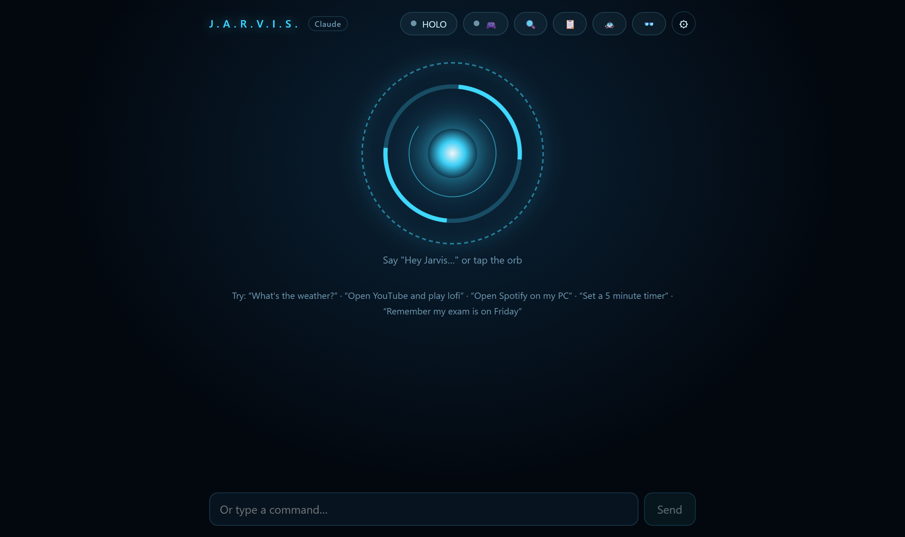
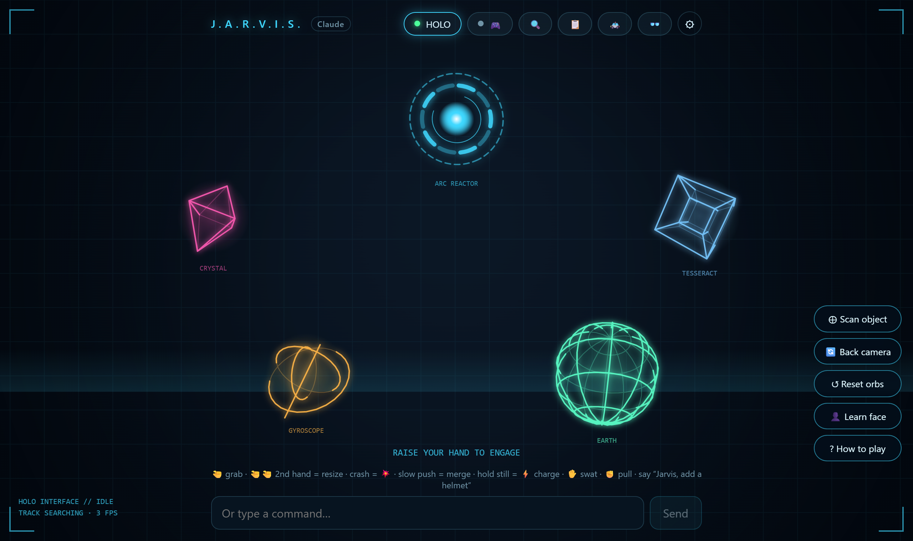
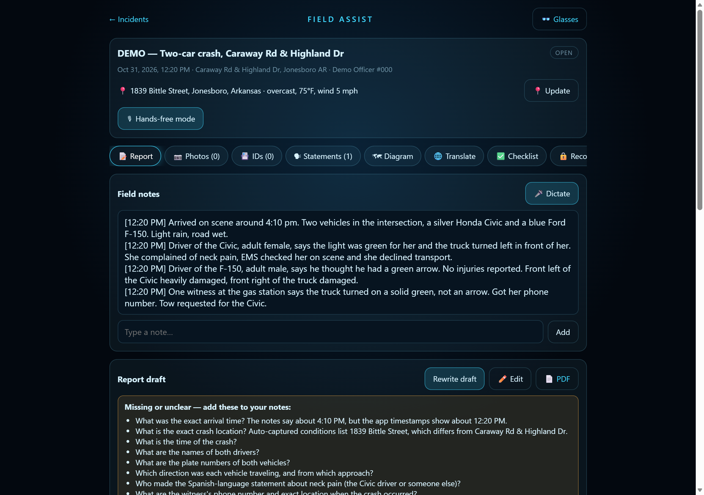
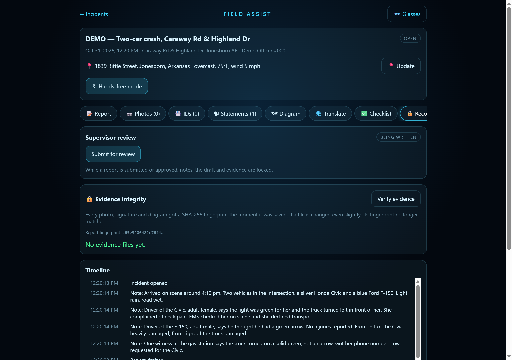
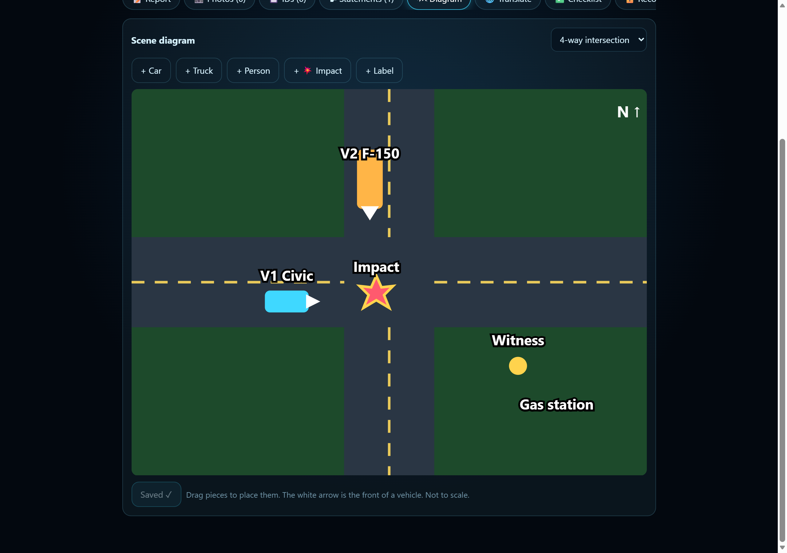
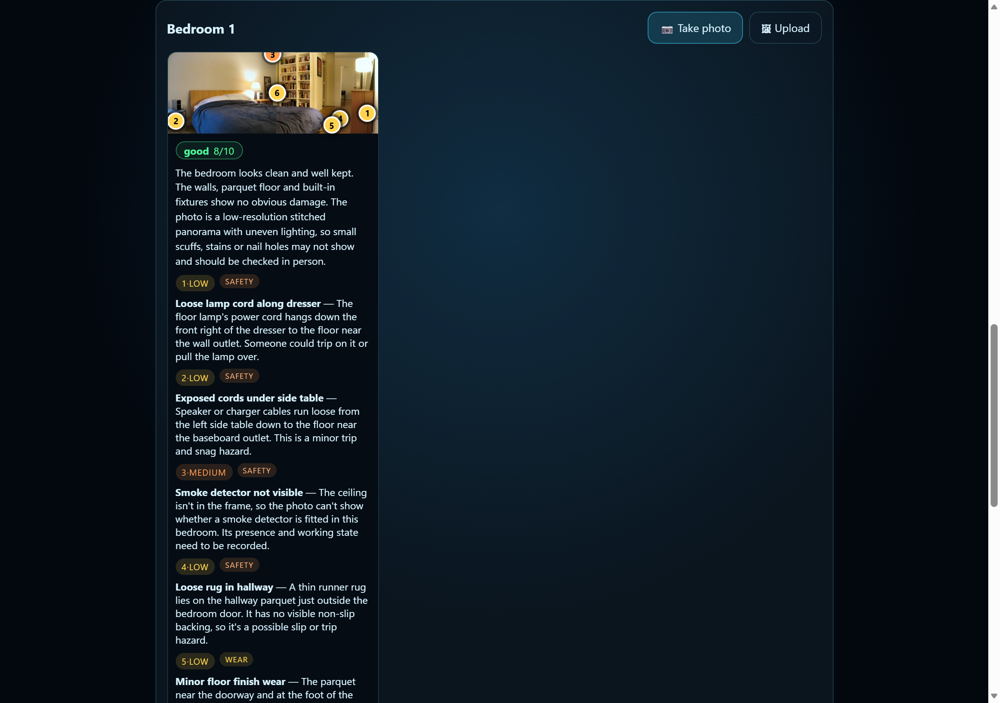
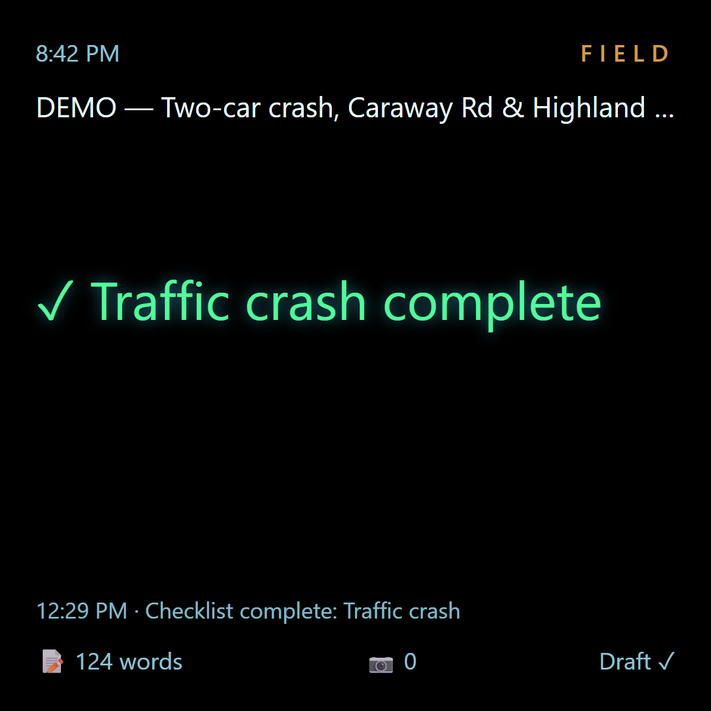
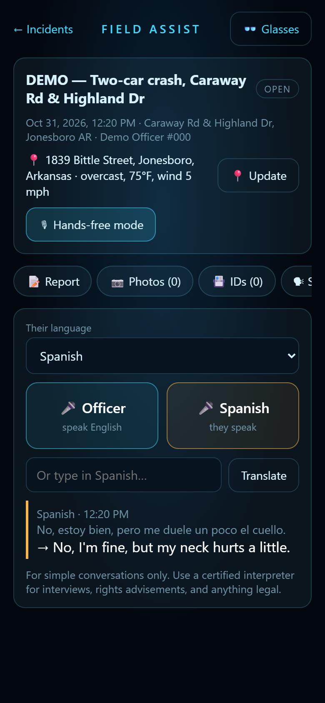
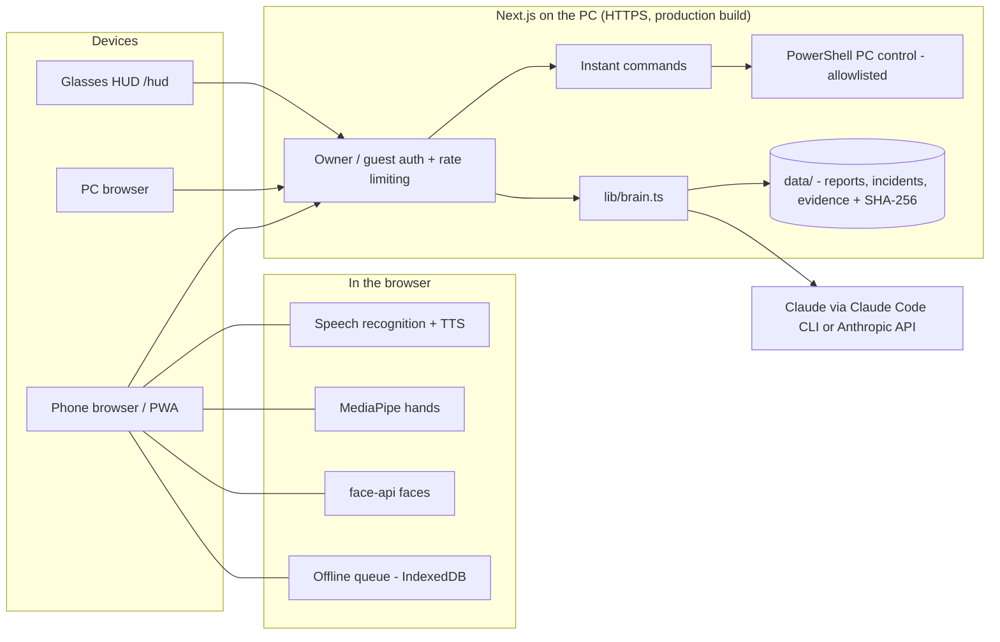

# J.A.R.V.I.S.

[](https://github.com/bibekbhattarai9811-create/jarvis/actions/workflows/ci.yml)
**[▶ Try the live demo](https://jarvis-demo-sandy.vercel.app)** (read-only sample data, sample answers; HOLO and face recognition run fully in your browser)

**An Iron Man–style assistant for your PC, phone and smart glasses, built on Claude.**
Talk to it, play with holograms using your hands, inspect rental properties room by room, and run a hands-free
field-report demo for public-safety use, all from one self-hosted Next.js app.



> Personal project by Bibek Bhattarai (data science + civil engineering, Arkansas State University).
> Field Assist is a **demo**, not certified for real police work.

---

## What's inside

### 🎙 Voice assistant
- Always listening for **"Hey Jarvis"**, or tap the orb. Replies are spoken; follow-up questions don't need the wake word.
- **Instant commands** (~0.3 s, no AI call): volume, media, timers, time and date, opening sites and apps, YouTube and Google searches.
- Everything else goes to Claude with live web search (~5 s). "Good morning" gives a daily briefing.
- Controls the PC it runs on (apps, media keys, lock screen), including from your phone.

### ✋ HOLO playground

- Hand tracking (MediaPipe) drives glowing 3D holograms: **pinch to grab, flick to throw**, resize with two hands.
- Crash two orbs to **blast** them; push them together slowly to **merge**; hold one still to **charge** a throw.
- **Scan a real object** with the camera and play with it as a hologram.
- **Face recognition** runs entirely in the browser (face-api), tags people you taught it, and never unlocks anything.

### 🚓 Field Assist (public-safety demo)
| Report | Record | Diagram |
|---|---|---|
|  |  |  |

- **Dictate field notes**, and Claude drafts a first-person incident report that **lists missing facts instead of inventing them**.
- **Hands-free mode**: "Jarvis, note: …", "take a photo of …", "scan ID for driver one", "next step", "translate Spanish".
- **Evidence integrity**: every photo, signature, ID scan and diagram gets a **SHA-256 fingerprint** on arrival; *Verify evidence* catches a single changed byte.
- **Supervisor review** (submit → approve / return, edits locked while under review) with a full **edit history** and **timeline**.
- **Witness statements** in 10 languages, read back and **signed on screen**; **two-way live translation**.
- **ID scanning** (consent-based): read the license a person hands over; the officer confirms every field.
- **Privacy blur** for public copies (faces and plates pixelated) and a **public PDF** that scrubs names, dates of birth and ID numbers.
- Crash **diagram editor**, GPS → address + weather, **works offline** (queues and syncs), and imports a department's **own policy as checklists**.
- **Deliberately no face recognition or plate lookups** of the public: accuracy, legal (e.g. Arkansas's ALPR law) and civil-rights reasons.

### 📋 Inspect Pro

- Room-by-room **move-in / move-out reports** for rentals: photos are analyzed by Claude vision with marked issues and a 1–10 score.
- Compares move-out with move-in and flags damage **beyond normal wear**; walkthrough checklists, voice notes, printable PDF.

### 👓 Smart glasses view
 

- A 600×600 see-through HUD (black = transparent) for Meta Ray-Ban Display–style glasses, plus a simulator.
- Shows the current checklist step, live translations, and inspection findings; a pinch moves on.
- `hardware/BUILD.md`: a low-budget DIY glasses prototype guide.

---

## Architecture



- **Claude** answers, drafts reports, translates, reads photos and IDs. Vision and drafting calls run with **no tools at all**, so text inside a photo or note can't make Claude read files.
- Runs on your own PC: data stays local in `data/` (git-ignored).

## Security

- Owner passcode vs. **guest code** (guests get chat + HOLO only: no PC control, memory, or reports).
- **Rate limiting**: 5 wrong guesses per address → 15-min lockout, plus a global limit; signed `HttpOnly` cookies.
- Own **certificate authority, name-constrained** to localhost + IP addresses, so trusting it can't vouch for real websites.
- PC "open app" is allowlisted (shells and system tools blocked); security headers; production build only.
- Uploaded evidence must really be a JPEG/PNG (magic bytes checked).

## Run it

Requirements: Windows, Node 20+, and either the logged-in [Claude Code](https://claude.com/claude-code) CLI or an `ANTHROPIC_API_KEY`.

```bash
npm install
copy .env.example .env.local   # set JARVIS_PIN
npm run build
npm start                      # https://localhost:3900
```

- Run `scripts\trust-certificate.bat` once to remove the browser warning (Windows asks you to confirm); phones can install `/jarvis-ca.crt`.
- `scripts/jarvis-hidden.vbs` runs it in the background; copy it to the Startup folder to start at sign-in.

## Tests

`npm test` runs 25 tests (Vitest), and GitHub Actions runs them plus a type-check and a full build on every push:

- **Instant commands**: everyday phrases are handled without AI; look-alike phrases go to Claude.
- **Login**: owner vs guest, lockout after 5 wrong guesses per address, signed cookies, real-JPEG uploads only.
- **Public redaction**: names, dates of birth (any format), ID numbers, streets and phone numbers never reach the public PDF.
- **Evidence**: fingerprints catch a single changed byte; approved evidence can't be deleted; old incidents upgrade cleanly.
- **HOLO physics**: lock-on, two-hand resize, blasts, merge-and-split, charge-up throws.

## Live demo

The demo is this same app built with `NEXT_PUBLIC_DEMO=1` and `JARVIS_DATA=demo` (see `demo/`): read-only sample data,
sample answers instead of Claude, no PC control. Deploy your own with `vercel deploy -b NEXT_PUBLIC_DEMO=1 -e NEXT_PUBLIC_DEMO=1 -e JARVIS_DATA=demo`.

## Tech

Next.js 15 · React 19 · TypeScript · Claude (Claude Code CLI / Anthropic API) · MediaPipe Tasks Vision · face-api ·
Web Speech API · Canvas 2D · IndexedDB + service worker · node-forge (local CA) · OpenStreetMap Nominatim · Open-Meteo

## Limits

Demo quality: voice features depend on the browser's speech engine; AI output must be reviewed by a person;
nothing here is certified for law-enforcement, legal, or inspection use.

## Credits

Inspect Pro example photo: [“BR”](https://commons.wikimedia.org/wiki/File:BR_(4151040962).jpg) by Francisco Anzola,
[CC BY 2.0](https://creativecommons.org/licenses/by/2.0/); the move-out copy was edited to add damage.
